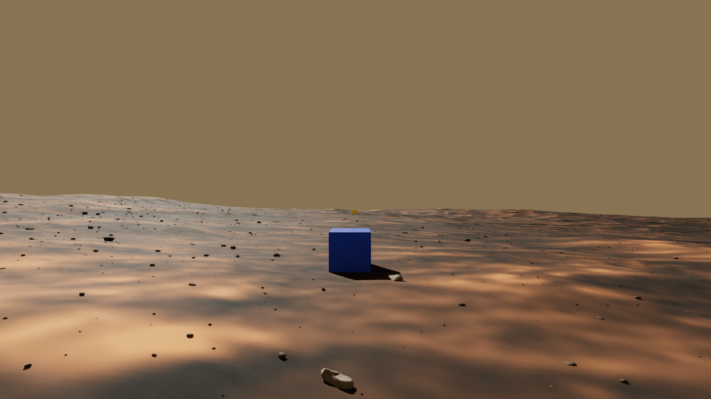
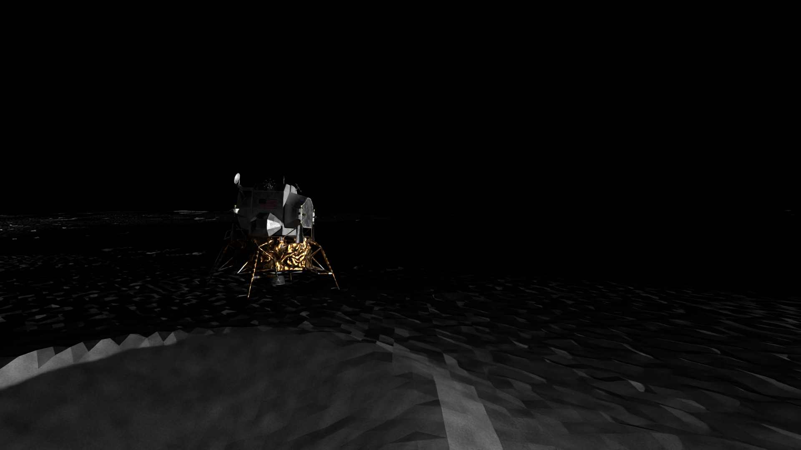
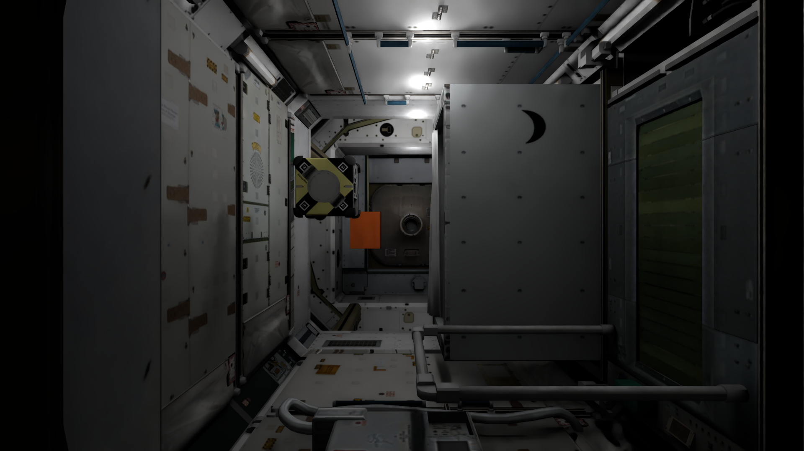
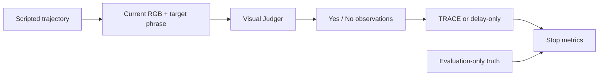
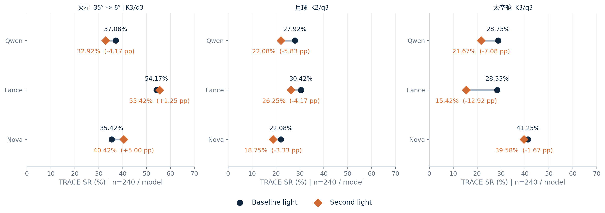

# Space VLA Benchmark

**Visual grounding and semantic stopping along fixed trajectories in simulated space environments.**

[GitHub](https://github.com/wwwwws12/space-vla-benchmark) · [Project page (local)](site/dist/index.html) · [中文](README.zh-CN.md) · [Protocol](docs/PROTOCOL.md) · [Data](docs/DATASET.md) · [Results](results/summary.json) · [Reproduce tables](docs/REPRODUCIBILITY.md)

> Private repository staging candidate. Author attribution and licenses await owner confirmation; public release and GitHub Pages deployment are pending. See [release status](RELEASE_STATUS.md).

<table><tr><td></td><td></td><td></td></tr><tr><td>Mars · baseline</td><td>Moon C · second light</td><td>Cabin · baseline</td></tr></table>

*Actual simulator RGB from existing dev examples; original PNG bytes. Illustrations show selected views, not performance rankings. [Image provenance and credits](docs/ASSETS.md).*

## Overview

Space VLA Benchmark examines whether a visual language model recognizes a target, and whether that judgment makes a robot stop at a useful location. It provides fixed scripted T-track trajectories in Mars, Moon and Cabin scenes, paired lighting conditions, and a common evaluation protocol for Qwen2.5-VL-3B, Lance_3B and Nova Lite 1.0.

The local simulator supplies frames and poses. A Judger sees only the current image and target phrase. Saved answers drive TRACE, delay-only and visibility-Oracle comparisons. Distance and visibility truth remain evaluation-only. This release describes a document-based independent implementation, with no claim of autonomous OpenFly navigation, real-robot validation or exact reproduction of an external campaign.

| Scale | Value |
|---|---:|
| Worlds / scenes | 3 / 9 |
| Unique paired routes | 900 |
| Images per lighting / total | 32,800 / 65,600 |
| Routes per scene | 20 dev + 80 test |
| Routes per world | 60 dev + 240 test |
| Judgers | 3 |
| Test model–route pairs per lighting | 2,160 |

The second lighting uses the same route IDs, targets, camera and split. Its dev images are collected; the comparison uses test routes with parameters frozen on baseline dev.

## Experimental design



| World | Baseline → second lighting | Frozen K/q |
|---|---|---|
| Mars | Solar elevation 35° → **8°** | 3/3 |
| Moon | A/B: sunlit → sun_east; C: psr → sunlit | 2/3 |
| Cabin | normal → dim; light intensity 60000 → 12000 | 3/3 |

Moon C solar-on is an artificial controlled comparison, not natural illumination of a geographic permanently shadowed region. Earlier Mars 15° runs are excluded from current results.

The three models contribute equally to dev selection in each world. Selection candidates are K∈{2,3}, q∈{1,2,3}; the full reported grid also includes K=1. Test data do not choose models, prompts or parameters. Query frames depend on each model's actual answer sequence. [Detailed protocol](docs/PROTOCOL.md).

## Results

Main TRACE at the frozen world-specific K/q, **240 test routes in every cell**:

| World | Judger | Baseline SR | Second-light SR | Δ (pp) |
|---|---|---:|---:|---:|
| Mars | Qwen2.5-VL-3B | 89/240 · 37.08% | 79/240 · 32.92% | -4.17 |
| Mars | Lance_3B | 130/240 · 54.17% | 133/240 · 55.42% | +1.25 |
| Mars | Nova Lite 1.0 | 85/240 · 35.42% | 97/240 · 40.42% | +5.00 |
| Moon | Qwen2.5-VL-3B | 67/240 · 27.92% | 53/240 · 22.08% | -5.83 |
| Moon | Lance_3B | 73/240 · 30.42% | 63/240 · 26.25% | -4.17 |
| Moon | Nova Lite 1.0 | 53/240 · 22.08% | 45/240 · 18.75% | -3.33 |
| Cabin | Qwen2.5-VL-3B | 69/240 · 28.75% | 52/240 · 21.67% | -7.08 |
| Cabin | Lance_3B | 68/240 · 28.33% | 37/240 · 15.42% | -12.92 |
| Cabin | Nova Lite 1.0 | 99/240 · 41.25% | 95/240 · 39.58% | -1.67 |



Across 2,160 model–route pairs, TRACE SR changes from **33.94% to 30.28%** (−3.66 percentage points). Seven of nine model×world groups decrease, two increase. TRACE is below delay-only in **9/9 baseline** and **8/9 second-light** groups. These negative results are retained; the paired differences are descriptive, not claims of statistical significance.

[All primary methods](results/summary.json) · [Full nine-grid numerical export](results/rollouts.jsonl.gz) · [Source hashes](results/provenance.json)

## Quick start: existing results, fully offline

Python 3.12+; the table scripts use only the standard library. No GPU, Isaac, model credentials or package installation is needed to aggregate the included numerical export.

```bash
python -B analysis/summarize_results.py
python -B analysis/summarize_results.py --method delay_only
python -B analysis/summarize_results.py --method oracle_visibility
python -B analysis/summarize_results.py --all-grid
```

This **reaggregates saved rollout metrics**. It does not regenerate images, model predictions or rollout outcomes. The release contains 120,960 numerical rollout rows (2 lightings × 3 models × 3 worlds × 240 routes × 28 cells). Repeated rows are not independent routes or additional model calls.

To preview the bilingual project page, open `site/dist/index.html` directly, or run:

```bash
python -m http.server 8765 --bind 127.0.0.1 --directory site/dist
```

Then visit `http://127.0.0.1:8765`. The page uses local assets only, with no analytics, CDN or API requests. [GitHub Pages setup](docs/PUBLISHING.md).

## What is included

| Location | Contents |
|---|---|
| `sfb/` | 18 unmodified core modules: actions, poses, TRACE, answer parsing, Judger adapters and visibility utilities |
| `analysis/` | Standalone aggregation of the supplied results |
| `results/` | Primary tables, full grid, route splits, dataset metadata and source hashes |
| `protocols/`, `configs/` | Public protocol projection, original data-format contract, camera/actions |
| `tools/verify_dataset.py` | Original standalone data integrity checker |
| `site/dist/` | Bilingual static introduction page, real scene examples and results explorer |
| `docs/` | Methodology, data specification, reproduction boundary, limitations and attribution |

The full RGB/semantic/mask datasets, third-party worlds/meshes, model weights, service-side adapters, private audit logs and workstation campaign launchers are **not included**. Data distribution remains pending. The HTTP clients require independently configured matching services; importing them does not launch inference. See [code scope](docs/CODE_SCOPE.md).

## Limitations and transparency

- Qwen online confirmation covers 180 baseline dev routes: action/pose prefixes and same-answer controller replay match on 180/180; stop frames match on 164/180. It does not cover all three models online.
- Cabin baseline versus online recapture has 83/1,086 frame pairs below 40 dB PSNR. The offline investigation found no collection-association/annotation error, but cross-process repeatability is not fully resolved.
- Cabin capture averages 1.273192 s/frame under its documented timing boundary; the HTTP-inclusive online loop averages 1.840710 s. These are different measurements.
- Cloud Nova weights and all request transformations are not independently observable; `campaign_match_verified=false`. Raw failures and authorized replacement attempts are retained in the private audit; the public metric projection is not a complete request-level audit.
- The fixed-route T track is the main experiment. N-track historical diagnostics are supplementary and excluded from these tables. External legacy-task compatibility is outside this independently developed delivery's scope.

[Full limitations](docs/LIMITATIONS.md) · [Licensing and third-party assets](docs/ASSETS.md)

## Attribution and citation

Author/affiliation metadata and software/data licenses await owner confirmation. No paper, DOI, institution, citation or open-source license is fabricated. The code is a publication candidate until that decision is recorded. Third-party assets require their own notices and distribution review.
