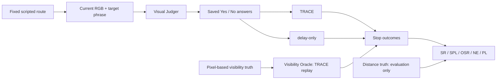

# Space VLA Benchmark

**Visual grounding and semantic stopping along fixed trajectories in simulated space environments.**

[GitHub](https://github.com/wwwwws12/space-vla-benchmark) · [Project page](https://wwwwws12.github.io/space-vla-benchmark/) · [中文](README.zh-CN.md) · [Protocol](docs/PROTOCOL.md) · [Data](docs/DATASET.md) · [Dataset downloads](https://wwwwws12.github.io/space-vla-benchmark/#dataset-downloads) · [Results](results/summary.json) · [Reproduce tables](docs/REPRODUCIBILITY.md)

[](https://wwwwws12.github.io/space-vla-benchmark/#demo)

Mars → Moon → Cabin, 4.8 seconds per scene in this animated preview. The [full video carousel](https://wwwwws12.github.io/space-vla-benchmark/#demo) supports inline playback and scene switching. Exported from existing dev frames; presentation pacing is not real-time operation. [Provenance](results/videos.json).

## Overview

Space VLA Benchmark examines whether a visual language model recognizes a target, and whether that judgment makes a robot stop at a useful location. It provides fixed scripted T-track trajectories in Mars, Moon and Cabin scenes, paired lighting conditions, and a common evaluation protocol for Qwen2.5-VL-3B, Lance_3B and Nova Lite 1.0.

The local simulator supplies frames and poses. A Judger sees only the current image and target phrase. Saved model answers drive TRACE and delay-only; pixel-based visibility truth drives the Oracle reference. Distance and visibility truth remain evaluation-only. The benchmark evaluates visual grounding and stopping decisions along fixed trajectories in simulation.

| Scale | Value |
|---|---:|
| Worlds / scenes | 3 / 9 |
| Unique paired routes | 900 |
| Images per lighting / total | 32,800 / 65,600 |
| Routes per scene | 20 dev + 80 test |
| Routes per world | 60 dev + 240 test |
| Judgers | 3 |
| Test model–route pairs per lighting | 2,160 |

The second lighting uses the same route IDs, targets, camera and split. Its dev images are collected; the comparison uses test routes with parameters frozen on baseline dev.

## Experimental design



| World | Baseline → second lighting | Frozen K/q |
|---|---|---|
| Mars | Solar elevation 35° → **8°** | 3/3 |
| Moon | A/B: sunlit → sun_east; C: psr → sunlit | 2/3 |
| Cabin | normal → dim; light intensity 60000 → 12000 | 3/3 |

Moon C solar-on is an artificial controlled comparison, not natural illumination of a geographic permanently shadowed region.

The three models contribute equally to dev selection in each world. Selection candidates are K∈{2,3}, q∈{1,2,3}; the full reported grid also includes K=1. Test data do not choose models, prompts or parameters. Query frames depend on each model's actual answer sequence. [Detailed protocol](docs/PROTOCOL.md).

## Dataset downloads

The complete baseline and second-light datasets are packaged separately from the code repository, in six world × lighting groups. Together they contain **900 unique paired routes and 65,600 frames**; the two lighting conditions share the same routes.

| World | Baseline frames | Second-light frames | Routes per lighting |
|---|---:|---:|---:|
| Mars | 9,879 | 9,879 | 300 |
| Moon | 10,821 | 10,821 | 300 |
| Cabin | 12,100 | 12,100 | 300 |

**[Open the dataset download panel](https://wwwwws12.github.io/space-vla-benchmark/#dataset-downloads)** for the actual archive sizes, individual ZIP files, SHA256 checksums and complete manifest. All 29 ZIP archives and both metadata files are available in the [dataset-v1.0 Release](https://github.com/wwwwws12/space-vla-benchmark/releases/tag/dataset-v1.0).

Each group includes RGB, semantic IDs and labels, target masks, route records, frozen dev/test splits and evaluation-only truth. Download every ZIP in the selected group, verify SHA256 and extract all ZIPs into the same directory. Each ZIP is independently extractable; do not concatenate files. Third-party scene source assets and model weights are not part of these data packages. [Download and verification guide](docs/DOWNLOADS.md).

## Results

Main TRACE at the frozen world-specific K/q, **240 test routes in every cell**:

| World | Judger | Baseline SR | Second-light SR | Δ (pp) |
|---|---|---:|---:|---:|
| Mars | Qwen2.5-VL-3B | 89/240 · 37.08% | 79/240 · 32.92% | -4.17 |
| Mars | Lance_3B | 130/240 · 54.17% | 133/240 · 55.42% | +1.25 |
| Mars | Nova Lite 1.0 | 85/240 · 35.42% | 97/240 · 40.42% | +5.00 |
| Moon | Qwen2.5-VL-3B | 67/240 · 27.92% | 53/240 · 22.08% | -5.83 |
| Moon | Lance_3B | 73/240 · 30.42% | 63/240 · 26.25% | -4.17 |
| Moon | Nova Lite 1.0 | 53/240 · 22.08% | 45/240 · 18.75% | -3.33 |
| Cabin | Qwen2.5-VL-3B | 69/240 · 28.75% | 52/240 · 21.67% | -7.08 |
| Cabin | Lance_3B | 68/240 · 28.33% | 37/240 · 15.42% | -12.92 |
| Cabin | Nova Lite 1.0 | 99/240 · 41.25% | 95/240 · 39.58% | -1.67 |


Across 2,160 model–route pairs, TRACE SR changes from **33.94% to 30.28%** (−3.66 percentage points). Seven of nine model×world groups decrease, two increase. TRACE is below delay-only in **9/9 baseline** and **8/9 second-light** groups. The paired differences are descriptive and do not establish statistical significance.

[All primary methods](results/summary.json) · [Full nine-grid numerical export](results/rollouts.jsonl.gz) · [Source hashes](results/provenance.json)


### TRACE K/q grids

Panels are arranged by world × Judger. Within each panel, rows are K and columns are q; each cell shows SR (%) over 240 test routes. Orange outlines mark dev-frozen settings, not test-selected optima. Mars second lighting uses an 8° solar elevation.


## Quick start: existing results, fully offline

Python 3.12+; the table scripts use only the standard library. No GPU, Isaac, model credentials or package installation is needed to aggregate the included numerical export.

```bash
python -B analysis/summarize_results.py
python -B analysis/summarize_results.py --method delay_only
python -B analysis/summarize_results.py --method oracle_visibility
python -B analysis/summarize_results.py --all-grid
```

This **reaggregates saved rollout metrics**. It does not regenerate images, model predictions or rollout outcomes. The release contains 120,960 numerical rollout rows (2 lightings × 3 models × 3 worlds × 240 routes × 28 cells). Repeated rows are not independent routes or additional model calls.

To preview the bilingual page with local dataset downloads, run from the repository root:

```powershell
powershell.exe -NoProfile -ExecutionPolicy Bypass -File .\scripts\preview_site.ps1
```

Then visit `http://127.0.0.1:8766/index.html`. Keep the preview window open while downloading. The page uses local assets, with no analytics or external CDN. Opening `site/dist/index.html` directly displays the page, but local dataset downloads require the preview launcher. [GitHub Pages setup](docs/PUBLISHING.md).

## What is included

| Location | Contents |
|---|---|
| `sfb/` | 18 core modules: actions, poses, TRACE, answer parsing, Judger adapters and visibility utilities |
| `analysis/` | Standalone aggregation of the supplied results |
| `results/` | Primary tables, full grid, route splits, dataset metadata and source hashes |
| `protocols/`, `configs/` | Public protocol projection, original data-format contract, camera/actions |
| `tools/verify_dataset.py` | Original standalone data integrity checker |
| `site/dist/` | Bilingual static introduction page, real scene examples and results explorer |
| `docs/` | Methodology, data specification, reproduction boundary, limitations and attribution |

The full RGB/semantic/mask datasets are distributed as separate [download packages](#dataset-downloads), rather than stored in this code repository. Third-party worlds/meshes, model weights and inference services are not included. The HTTP clients require separately configured matching model services. See [code scope](docs/CODE_SCOPE.md).

## Limitations and transparency

- Qwen online confirmation covers 180 baseline dev routes: action/pose prefixes and same-answer controller replay match on 180/180; stop frames match on 164/180. It does not cover all three models online.
- Cabin baseline versus online recapture has 83/1,086 frame pairs below 40 dB PSNR. Cross-process image repeatability remains a limitation.
- Cabin capture averages 1.273192 s/frame under its documented timing boundary; the HTTP-inclusive online loop averages 1.840710 s. These are different measurements.
- Nova is accessed through a cloud API; its deployed weights and provider-side processing cannot be independently inspected.
- Results cover fixed scripted trajectories in simulation. Autonomous navigation and real-robot performance are outside the evaluated scope.

[Full limitations](docs/LIMITATIONS.md) · [Licensing and third-party assets](docs/ASSETS.md)

## Attribution and citation

Author and affiliation details and software/data licenses are pending confirmation. Third-party materials retain their own attribution and distribution requirements.
