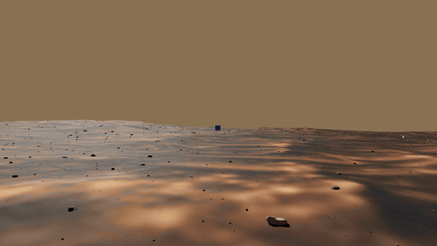
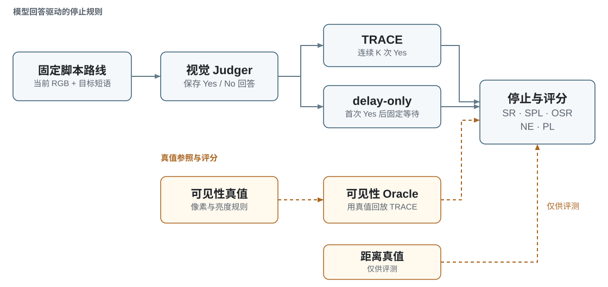
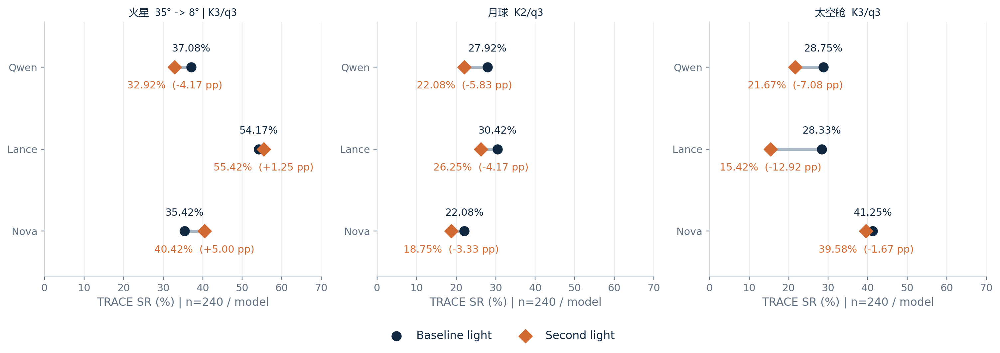
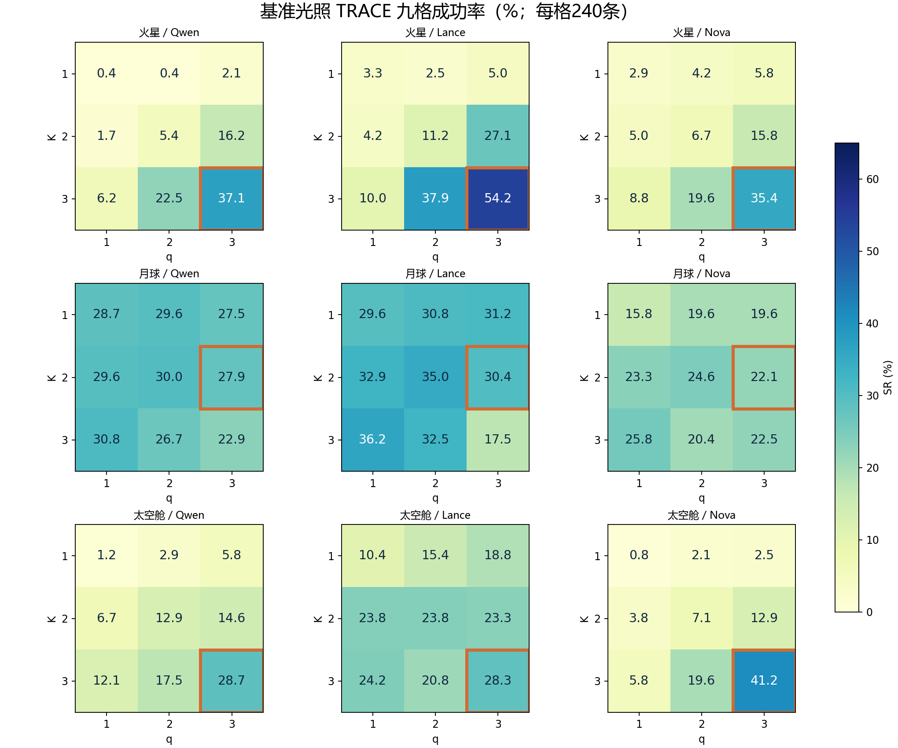
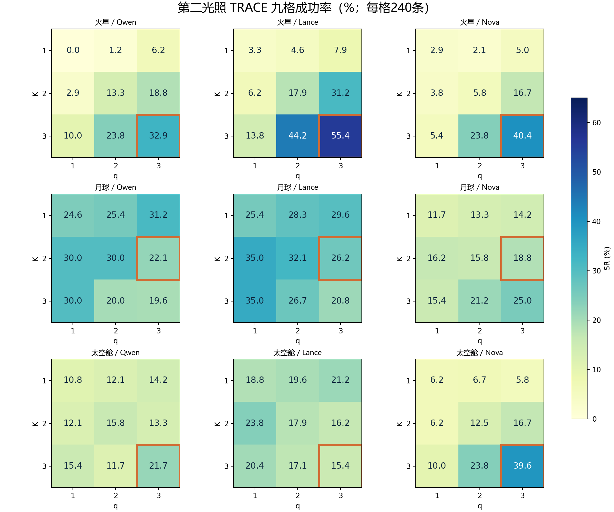

# 太空 VLA Benchmark

**在太空仿真环境的固定轨迹上，评测视觉目标识别与语义停止策略。**

[GitHub](https://github.com/wwwwws12/space-vla-benchmark) · [项目介绍页](https://wwwwws12.github.io/space-vla-benchmark/index.zh-CN.html) · [English](README.md) · [评测协议](docs/PROTOCOL.md) · [数据说明](docs/DATASET.md) · [数据下载](https://wwwwws12.github.io/space-vla-benchmark/index.zh-CN.html#dataset-downloads) · [完整结果](results/summary.json)

[](https://wwwwws12.github.io/space-vla-benchmark/index.zh-CN.html#demo)

**火星 → 月球 → 太空舱，自动循环预览。** [打开完整视频轮播](https://wwwwws12.github.io/space-vla-benchmark/index.zh-CN.html#demo)，可在页面内播放并点击切换场景。

README内展示每场景4.8秒的循环动图；完整视频由已有dev路线的真实仿真帧导出，播放节奏不代表实时运行速度。[视频来源](results/videos.json)。

## 项目研究什么？

模型判断“看到了目标”，是否就能让机器人在合适的位置停止？本项目采用Mars、Moon、Cabin各三个场景的脚本T轨，比较Qwen2.5-VL-3B、Lance_3B和Nova Lite 1.0在两种光照下的目标可见性判断，以及TRACE、delay-only、可见性Oracle的停止表现。

Isaac Sim负责渲染，模型只接收当前图像和目标短语。距离、坐标、mask和前次回答不进入模型输入。本基准评测仿真固定轨迹上的视觉目标识别与停止决策，实验范围不包含自主导航与真机验证。

## 数据与划分

- 3世界、9场景、900条独立路线，两种光照分别32,800帧，共65,600帧。
- 每场景100条＝20 dev＋80 test；每世界60 dev＋240 test。
- 三模型基准dev等权共同选参，冻结Mars K3/q3、Moon K2/q3、Cabin K3/q3；test不调参。
- 第二光照保持路线、目标、相机和划分不变，直接沿用冻结参数。
- Mars太阳高度角35°→**8°**；Moon A/B改变太阳方位，C为人工solar-on对照；Cabin灯强60000→12000。

## 实验设计



模型只接收当前RGB与目标短语，保存的Yes/No回答分别驱动TRACE和delay-only；可见性真值单独驱动Oracle参照，距离真值用于评分。三种规则使用同一固定路线与冻结K/q。

## 数据下载

完整基准光照与第二光照数据按“世界 × 光照”分成六组，独立于代码仓库打包。两种光照共享路线，共 **900 条独立配对路线、65,600 帧**。

| 世界 | 基准光照帧数 | 第二光照帧数 | 每种光照路线数 |
|---|---:|---:|---:|
| Mars | 9,879 | 9,879 | 300 |
| Moon | 10,821 | 10,821 | 300 |
| Cabin | 12,100 | 12,100 | 300 |

**[打开数据下载区](https://wwwwws12.github.io/space-vla-benchmark/index.zh-CN.html#dataset-downloads)**，查看实际包体积、各 ZIP、SHA256 和完整清单。29个ZIP分包及两份清单均已在 [dataset-v1.0 Release](https://github.com/wwwwws12/space-vla-benchmark/releases/tag/dataset-v1.0) 发布，可直接下载。

每组包含 RGB、语义 ID 与标签、目标 mask、路线记录、冻结 dev/test 划分及仅供评测的真值。下载所选组的全部 ZIP，校验 SHA256 后统一解压到同一个目录；每个 ZIP 均可独立解压，无需拼接。第三方场景源资产与模型权重不包含在数据包中。[下载与校验说明](docs/DOWNLOADS.md)。

## 主结果

主TRACE，每个单元格均为240条test路线：

| 世界 | 模型 | 基准 SR | 第二光照 SR | 差值（pp） |
|---|---|---:|---:|---:|
| Mars | Qwen2.5-VL-3B | 89/240 · 37.08% | 79/240 · 32.92% | -4.17 |
| Mars | Lance_3B | 130/240 · 54.17% | 133/240 · 55.42% | +1.25 |
| Mars | Nova Lite 1.0 | 85/240 · 35.42% | 97/240 · 40.42% | +5.00 |
| Moon | Qwen2.5-VL-3B | 67/240 · 27.92% | 53/240 · 22.08% | -5.83 |
| Moon | Lance_3B | 73/240 · 30.42% | 63/240 · 26.25% | -4.17 |
| Moon | Nova Lite 1.0 | 53/240 · 22.08% | 45/240 · 18.75% | -3.33 |
| Cabin | Qwen2.5-VL-3B | 69/240 · 28.75% | 52/240 · 21.67% | -7.08 |
| Cabin | Lance_3B | 68/240 · 28.33% | 37/240 · 15.42% | -12.92 |
| Cabin | Nova Lite 1.0 | 99/240 · 41.25% | 95/240 · 39.58% | -1.67 |



2160个模型×路线对的主TRACE成功率由**33.94%降至30.28%**。9组中7组下降、2组上升。基准9/9、第二光照8/9组TRACE低于delay-only。上述差异为描述性比较，不代表统计显著性结论。

网页可切换四种策略查看SR/SPL；结果文件还包含全部九格。Oracle用可见性真值替代模型回答，不是距离成功率的理论上界。

### TRACE 参数九宫图

基准光照与第二光照分别展示世界×模型的九宫图。每幅小图纵轴为K、横轴为q，单元格为240条test路线的成功率（%）；橙框为dev冻结参数，不用test重新选参。Mars第二光照采用8°结果。





## 本地使用

使用Python3.12+即可汇总已有数值结果，无需安装依赖、启动模型或Isaac：

```powershell
python -B analysis/summarize_results.py
python -B analysis/summarize_results.py --method delay_only
python -B analysis/summarize_results.py --method oracle_visibility
python -B analysis/summarize_results.py --all-grid
```

上述命令重新聚合已保存的120960行回放指标，**不是重新推理或从图像重建成绩**。完整图像通过[独立数据包](#数据下载)提供，不放入代码仓库；第三方场景源资产和模型权重不包含在内。

在仓库根目录运行以下命令，可预览介绍页并下载本地数据包：

```powershell
powershell.exe -NoProfile -ExecutionPolicy Bypass -File .\scripts\preview_site.ps1
```

然后访问`http://127.0.0.1:8766/index.zh-CN.html`，下载期间保持预览窗口开启。无需Node、前端构建工具或外部CDN。双击`site/dist/index.zh-CN.html`也能查看页面，但本地数据下载需要上述预览服务。

## 文件导航

| 目录 | 内容 |
|---|---|
| `sfb/` | 动作、位姿、TRACE、回答解析和模型接口等18个核心模块 |
| `results/` | 主表、全部九格、路线划分、数据清单与SHA来源 |
| `analysis/` | 离线汇总入口 |
| `site/dist/` | 中英文介绍页、真实双光照示例、交互结果表 |
| `protocols/`、`configs/` | 评测约定、数据格式与相机/动作配置 |
| `docs/` | 使用、复现边界、已知限制与发布说明 |

## 如实披露的边界

Qwen基准180条dev在线确认完成，动作/位姿前缀与同回答回放180/180一致，停止帧164/180一致。Cabin原光照与在线重拍83/1086组PSNR低于40dB；跨进程重拍的图像一致性仍存在限制。采集1.273192秒/帧与含HTTP在线循环1.840710秒的计时口径不同。

Nova通过云端API访问，部署权重与服务端处理过程无法独立检查。详见[限制](docs/LIMITATIONS.md)。

作者、单位及代码和数据许可证待确认。第三方素材保留各自的署名与分发要求。详见[发布说明](docs/PUBLISHING.md)。
